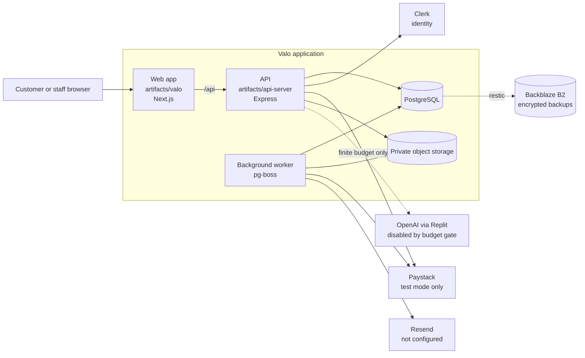

# Valo architecture

This describes how Valo is built today and where it is heading. The phased
change plan is in [plan.md](plan.md); decisions are recorded in
[decisions/](decisions/).

## System context



## Processes

| Process | Entry point | Responsibility |
| --- | --- | --- |
| Web | `artifacts/valo/app/[[...slug]]/page.tsx` | Serves the site. Public pages and the private workspace render client-side today; the public pages move to the server one at a time (decision 0011). |
| API | `artifacts/api-server/src/index.ts` | All reads and writes, authentication, authorization, webhooks. |
| Worker | `artifacts/api-server/src/workers/export-worker.ts` | DOCX/PDF exports, workspace data exports, retention, payments, refunds, disputes, reminders. |
| Supervisor | `artifacts/api-server/src/workers/export-supervisor.ts` | Restarts the worker within limits and reports health. |
| Host manager | `scripts/ops/runtime_host.py` | Runs API and worker together on a single host (production rehearsal). |

In production mode the API answers only `GET /api/healthz` and returns 503 for
everything else. This is deliberate: no production launch is approved.

## Packages

| Package | Responsibility |
| --- | --- |
| `lib/api-spec` | The OpenAPI contract, the single source of truth for HTTP shapes: one file per module in `src/`, which `bundle.mjs` joins into `openapi.yaml`. |
| `lib/api-zod`, `lib/api-client-react` | Generated validation and React Query client. Never edited by hand. |
| `lib/db` | Drizzle schema, append-only SQL migrations, guarded schema tooling. |
| `lib/valo-core` | Logic shared by API and web: guided forms, money, checker, publication rules, content catalogue and inventory. |
| `lib/valo-records` | Requirement and evidence bookkeeping: requirement records, traceability and readiness, evidence links, acceptance work items, handover checkpoint. Depends on `valo-core`; the API reads it only to report status. |
| `lib/integrations-openai-ai-server` | OpenAI client configured through Replit AI Integrations. |
| `scripts` | Readiness report, register synchronisation, security scans. |
| `scripts/ops` | Backup, restore, retention replay and planning, release manifest, host supervision, container image check. |

Releases, rollback, environment profiles, backup retention and alerts are described in
[docs/valo/release-and-rollback.md](../valo/release-and-rollback.md). The `Dockerfile` builds
the API and web images; no environment runs them yet.

## Public pages on the server

The public pages are moving from the browser to the server, one step at a time
([decision 0011](decisions/0011-server-rendered-public-pages.md)). A page renders in the browser,
as before, until its own route lands.

The web server reads the API only through `artifacts/valo/src/server/public-api.ts`, as an anonymous
visitor:
- It sends no cookie and no `Authorization` header, so a server-rendered page holds only what any
  anonymous visitor may see, the same for every visitor.
- It passes on the `X-Forwarded-For` header it received. The API counts each visitor separately
  only once `VALO_TRUSTED_PROXY_CIDRS` trusts the web server, after a deployed topology has been
  observed; until then server-rendered reads share one rate-limit budget.
- It checks every answer with the contract's schema, refuses redirects, caps an answer at 4 MiB and
  gives up after 1.5 seconds. A failure comes back as a reason (`not-found`, `refused`, `failed`,
  `unconfigured`), so a page renders its unavailable or error state.
- The API's address is `VALO_API_INTERNAL_ORIGIN`, or else the configured public origin, which
  serves the API under `/api`. Outside development it must be https, or plain http to this
  machine's loopback address. A set but unusable value is refused, never replaced.

The metadata and the sitemap read discovery through it (`src/server/page-api.ts`). When a request
carries no `X-Forwarded-For`, Next supplies the address of the connection it came from. The
repository rule `public-server` keeps the identity SDK and the browser's API client out of the code
a public page runs on the server, and lets the islands it renders load the identity SDK only with
`import()`.

Each server-rendered page is a route under `artifacts/valo/app/(public)`, listed in
`src/lib/server-pages.ts`. Their layout renders the site's frame on the server
(`src/components/public-shell.tsx`): the same banner, header, footer and dock as the browser app's
shell, from the same parts (`site-chrome.tsx`). Islands in `src/islands` add what needs the browser:
- the menu button, and the current section in the header;
- the account links and the dock, which show the signed-out links until the identity provider has
  loaded. `IdentityLoader` loads it once the page is interactive and the browser is idle, and the
  islands read what it reports (`identity-store.ts`). The content never waits for it.

Moving between a server-rendered page and the browser app loads the new page in full: each side
links to the other with a plain link. When the browser app reaches a server-rendered address some
other way, such as a link inside one of its screens, it reloads the address so the server renders
it (`src/components/server-page.tsx`); if the server sent the address back to the browser app, it
says so instead of reloading again.

Checks that run the compiled web app point it at a synthetic API on the loopback address
(`artifacts/api-server/src/test-support/synthetic-api.ts`, `web-server.ts`).

## Invariants

Every change must keep these true. Each has tests; none may be weakened.

1. **Tenant isolation.** Every private query is scoped to the workspace the
   server resolves from the verified session. Writes re-check membership inside
   the transaction, so a revocation that commits first wins.
   `valo-tenant-substitution.integration.test.ts` tries every private route that
   takes an identifier with another workspace's identifiers. Below the application,
   every customer request acts as `valo_workspace_scope`, and row-level security
   limits it to the workspace's rows even if a query forgets its filter. That role
   holds only the table privileges customer requests use. Customer connections log
   in as `valo_workspace_login`, which holds nothing else, and name their workspace
   with a credential the application signs for each transaction, so SQL on a
   customer connection can neither act as the application role nor reach another
   workspace. Background work for one workspace (exports, reminders, a staff privacy
   export) reads that workspace's data in its scope too (decision 0008).
2. **Identity.** Private requests require an active Clerk session and a verified
   primary email. Payments, downloads, privacy and AI drafts check Clerk live on
   every request; listed everyday routes re-check at least once a minute
   (decision 0003). Staff routes first refuse any account without an active staff
   assignment, before reading input; staff actions also require both MFA factors
   and a fresh check.
3. **Same-origin writes.** Mutations require the configured exact origin and a
   JSON body.
4. **Immutable history.** Document revisions, publication records, audit logs,
   dispute history and staff role changes are append-only; database triggers
   enforce it.
5. **Publication gates.** Content and rules reach customers only through the
   editorial gates. Public reads re-check eligibility on every request.
6. **Payments.** Access is granted only after server-side verification with the
   provider. Test keys only; live mode needs a code change.
7. **AI spend.** Model calls run only inside an owner-approved finite budget
   context created by server code, never from an HTTP request. The operator
   commands that create it hand the dispatcher the checks that compare each
   approved work with the current code; only those commands may, and only with
   the real checks.
8. **Privacy.** Logs carry no private document text. Erasure works only on
   synthetic identities until a reviewed production procedure exists.
9. **Development guards.** Development-only features refuse to run when
   `NODE_ENV` is not `development` or a Replit deployment marker is present.
10. **One connection per transaction.** Code inside a transaction uses only that
    transaction's connection, so concurrent requests cannot exhaust the pool while
    each waits for a second one. The CI database job fails on any other pooled
    connection taken inside a transaction, apart from the reviewed exceptions in
    `nested-connection-report.mjs`.
11. **The schema describes the database.** Every primary key, unique constraint,
    foreign key, check constraint and index on a table in the Drizzle schema
    exists in a migrated database with the name and shape the latest snapshot
    records (check expressions as PostgreSQL normalizes them), so a generated
    migration can name what it changes. The migration tests fail on any
    difference (`lib/db/scripts/snapshot-parity.mjs`).

## Target structure

The API is moving from a flat `src/lib` folder to one folder per business
capability, each with a single public entry file:

```
artifacts/api-server/src/
  platform/      settings, database, identity context, queue, storage, logging, errors
  modules/
    workspaces/  documents/  exports/  catalogue/  sources/
    publication/  editorial/  rules/  tasks/  commerce/  ai/  ai-lanes/
    support/  privacy/  staff/  operations/  recovery/
  api.ts         HTTP entry point
  worker.ts      background entry point
```

Rules:

- Code outside a module, another module included, imports it only through its
  `index.ts`. The repository rules checker enforces this (`module-boundary`);
  tests may import a module's files directly.
- Only `platform/` reads environment variables or creates clients.
- HTTP handlers and jobs call module services; only a module's own data layer
  touches its tables.

The other rules are enforced by tooling as each phase lands. See [plan.md](plan.md)
for the order of work and what is already done.

`modules/ai` is the first module. It holds the finite inference core: the budget
and its ledger, history reconciliation, approved manifests and allocation packages,
and the dispatcher with its provider transport. `index.ts` does not export the
transport, so disabled inference never loads it.

`modules/ai-lanes` holds the work that runs through that dispatcher
([decision 0013](decisions/0013-move-the-ai-lanes.md)):
- the customer AI lane, with its drafts, model contract, case bindings and evaluation cases;
- the operational review lane;
- the history loader;
- the work-binding checks that the operator commands hand the dispatcher.

The lanes are clients of `modules/ai`, so the dependency runs one way: nothing in `modules/`
imports `modules/ai-lanes`; the customer AI route and the operator commands do. Like `modules/ai`,
its index loads no database client, model SDK or provider transport, and
`inference-no-database.test.ts` imports both indexes to check it.

`modules/commerce` is the second. It holds one-time purchases, payment events and their
reconciliation, receipts and their recovery, refunds, payment concerns, disputes and the Paystack
contract. Its `index.ts` re-exports what the routes, the worker and the privacy code use; the
merchant transports, the dispute schema and the test fixtures stay internal. The routes stay in
`src/routes`.

`modules/rules` holds the released-rule registry the checker uses, saved assessments, their
comparison and the admission check for a rule release. The rule release command itself lives in
`modules/editorial`, because it binds sources through the sources module's storage, which the rules
module must not load into every reader of assessments.

The editorial code is three modules, each depending only on the ones after it:
`modules/editorial`, then `modules/publication`, then `modules/sources`.

- `modules/sources` fetches, extracts and stores official source snapshots, keeps their identities
  and registers, and holds the source bindings a rule release uses, the business-name source
  evidence, the current-source state with its lock and the source corrections that change it, the
  staff source controls and the daily source check. The controls load the staff checks, like the
  database client, only when a staff request runs.
- `modules/publication` holds the operational publication policy and its restrictions, release
  artifacts, the intake and content of original operational templates and the list of those whose
  AI preparation is supported, their mechanical, export, rights and final checks, and the
  publisher. The catalogue reads published content through it,
  and it loads no AI code.
- `modules/editorial` holds the AI pipeline and its model adapter, operational authoring and review,
  release preparation, the editorial lifecycle with its dispatch and sandbox, evaluation evidence
  and the rule release command.

Importing a module's index loads every file it re-exports, so these modules load the database
client only inside the functions that query it, as `modules/ai` does. Code and tests that need one
editorial function therefore load no database client, and tests that stand in for a dependency
mock the module's index, the boundary the code imports it through.

`modules/catalogue` holds the public catalogue, its search and discovery, the released content
customers may read or download, and saved templates. It reads published content through
`modules/publication`, and the editorial lifecycle and commerce read it in turn. Like the editorial
modules, it and the store, quota and privacy key files it reaches load the database client only
when a function queries it, so the catalogue browser check runs without a database.

`modules/exports` holds document exports and their queue, crash recovery and retention.
Rendering (`src/lib/valo-render.ts`) stays shared: publication checks and release preparation
render documents too. The read-only retention inventory (`src/lib/valo-export-retention-inventory.ts`)
stays outside the module: its operator command must refuse its arguments before it opens a
database connection, and the module's index loads the export code and its database client.

`modules/privacy` holds privacy requests and their processing, erasure with its seal, lock and
inventory, redaction, private copies and the authority that clears them for cleanup, the customer's
account and access requests, the data download, and the workspace data export with its jobs and
storage. Five files stay outside:

- The privacy keys and their audit state (`src/lib/valo-privacy-keys.ts`, `valo-privacy-state.ts`).
  Workspace resolution checks erased identities with the keys, and the privacy code checks
  workspace access, so reaching the keys through the privacy module's index would make an import
  cycle.
- The recovery erasure (`src/modules/recovery/valo-recovery-erasure.ts`) stays with the other
  recovery tools. Only the guarded recovery child loads it, and it brings its own database driver.
- The HTTP side of the data download and the workspace export (`src/lib/valo-data-download-http.ts`,
  `valo-workspace-export-http.ts`). Only the customer-access routes use them. They load Express and
  the identity SDK, which the export worker, reaching privacy through the index, does not need. And
  the repository rules treat a `src/lib/*-http.ts` file as HTTP code, which may not create a
  workspace actor (`workspace-actor`).

`modules/staff` holds staff authority (the active role assignments and the recent multi-factor
check every staff action needs), staff role administration and the read-only operations summary
of each staff area. The identity SDK loads only when a
role change looks up its target account, so code that only checks staff authority never loads it.

`modules/tasks` holds customer tasks and their pages, reminder preferences, the reminder worker and
the development reminder email. `modules/support` holds support tickets, the intake that opens a
support case from a ticket or an access or privacy request, and the support lifecycle: cases, their
messages, staff assignment and escalations.

The store that held workspaces, documents and support tickets together is split
([decision 0012](decisions/0012-split-the-store.md)):
- `modules/workspaces` holds the workspace access checks and write limits every workspace's
  records go through, the audit trail they write, workspace resolution and the workspace with its
  profile. Workspace resolution is the only place an identity's membership becomes a workspace
  actor (repository rule `workspace-actor`).
- `modules/documents` holds a workspace's business drafts, their revisions and the revision codec.
  It depends on `modules/workspaces`, never the other way.
- Support tickets joined `modules/support` above.

There is no `identity` module: session verification and the workspace context are the identity
context in `platform/`.

`modules/operations` holds the scheduled queue the development worker runs the operational tasks
on, the worker heartbeat, the operational sample and the internal alerts with the runbook each
names. `modules/recovery` holds the signed recovery controls that the isolated recovery and the
separate-host replay apply, the checks that their target is a disposable recovery database, and the
recovery erasure. Its index does not load the erasure, which brings its own database driver and the
privacy module: the guarded recovery child loads it through `loadRecoveryErasure` when it runs. The
guard that refuses Paystack, dispute and reminder email calls during an isolated recovery, and stops
the worker starting, is `platform/valo-recovery-effects.ts`: commerce, the reminders and the worker
all check it, and it reads only the settings.

The proposed R2 team access model (roles, grants, invitations and the migration path)
is in [r2-team-access.md](r2-team-access.md).
