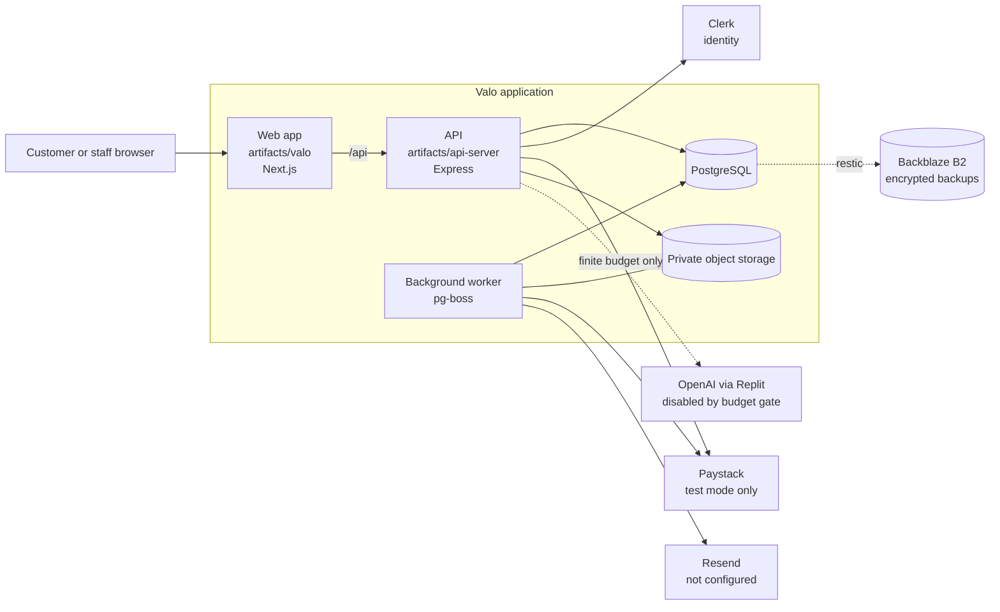

# Valo architecture

This describes how Valo is built today and where it is heading. The phased
change plan is in [plan.md](plan.md); decisions are recorded in
[decisions/](decisions/).

## System context



## Processes

| Process | Entry point | Responsibility |
| --- | --- | --- |
| Web | `artifacts/valo/app/[[...slug]]/page.tsx` | Serves the site. Public pages and the private workspace render client-side today. |
| API | `artifacts/api-server/src/index.ts` | All reads and writes, authentication, authorization, webhooks. |
| Worker | `artifacts/api-server/src/workers/export-worker.ts` | DOCX/PDF exports, workspace data exports, retention, payments, refunds, disputes, reminders. |
| Supervisor | `artifacts/api-server/src/workers/export-supervisor.ts` | Restarts the worker within limits and reports health. |
| Host manager | `scripts/ops/runtime_host.py` | Runs API and worker together on a single host (production rehearsal). |

In production mode the API answers only `GET /api/healthz` and returns 503 for
everything else. This is deliberate: no production launch is approved.

## Packages

| Package | Responsibility |
| --- | --- |
| `lib/api-spec` | The OpenAPI contract, the single source of truth for HTTP shapes. |
| `lib/api-zod`, `lib/api-client-react` | Generated validation and React Query client. Never edited by hand. |
| `lib/db` | Drizzle schema, append-only SQL migrations, guarded schema tooling. |
| `lib/valo-core` | Logic shared by API and web: guided forms, money, checker, publication rules, plus requirement and evidence registers. |
| `lib/integrations-openai-ai-server` | OpenAI client configured through Replit AI Integrations. |
| `scripts` | Readiness report, register synchronisation, security scans. |
| `scripts/ops` | Backup, restore, retention replay and planning, release manifest, host supervision, container image check. |

Releases, rollback, environment profiles, backup retention and alerts are described in
[docs/valo/release-and-rollback.md](../valo/release-and-rollback.md). The `Dockerfile` builds
the API and web images; no environment runs them yet.

## Invariants

Every change must keep these true. Each has tests; none may be weakened.

1. **Tenant isolation.** Every private query is scoped to the workspace the
   server resolves from the verified session. Writes re-check membership inside
   the transaction, so a revocation that commits first wins.
   `valo-tenant-substitution.integration.test.ts` tries every private route that
   takes an identifier with another workspace's identifiers.
2. **Identity.** Private requests require an active Clerk session and a verified
   primary email. Payments, downloads, privacy and AI drafts check Clerk live on
   every request; listed everyday routes re-check at least once a minute
   (decision 0003). Staff routes first refuse any account without an active staff
   assignment, before reading input; staff actions also require both MFA factors
   and a fresh check.
3. **Same-origin writes.** Mutations require the configured exact origin and a
   JSON body.
4. **Immutable history.** Document revisions, publication records, audit logs,
   dispute history and staff role changes are append-only; database triggers
   enforce it.
5. **Publication gates.** Content and rules reach customers only through the
   editorial gates. Public reads re-check eligibility on every request.
6. **Payments.** Access is granted only after server-side verification with the
   provider. Test keys only; live mode needs a code change.
7. **AI spend.** Model calls run only inside an owner-approved finite budget
   context created by server code, never from an HTTP request.
8. **Privacy.** Logs carry no private document text. Erasure works only on
   synthetic identities until a reviewed production procedure exists.
9. **Development guards.** Development-only features refuse to run when
   `NODE_ENV` is not `development` or a Replit deployment marker is present.
10. **One connection per transaction.** Code inside a transaction uses only that
    transaction's connection, so concurrent requests cannot exhaust the pool while
    each waits for a second one. The CI database job fails on any other pooled
    connection taken inside a transaction, apart from the reviewed exceptions in
    `nested-connection-report.mjs`.

## Target structure

The API is moving from a flat `src/lib` folder to one folder per business
capability, each with a single public entry file:

```
artifacts/api-server/src/
  platform/      settings, database, identity context, queue, storage, logging, errors
  modules/
    identity/  workspaces/  documents/  exports/  catalogue/  editorial/
    rules/  tasks/  commerce/  ai/  support/  privacy/  staff/
  api.ts         HTTP entry point
  worker.ts      background entry point
```

Rules:

- A module may import another module only through its `index.ts`.
- Only `platform/` reads environment variables or creates clients.
- HTTP handlers and jobs call module services; only a module's own data layer
  touches its tables.

These rules are enforced by tooling as each phase lands. See [plan.md](plan.md)
for the order of work and what is already done.

The proposed R2 team access model (roles, grants, invitations and the migration path)
is in [r2-team-access.md](r2-team-access.md).
